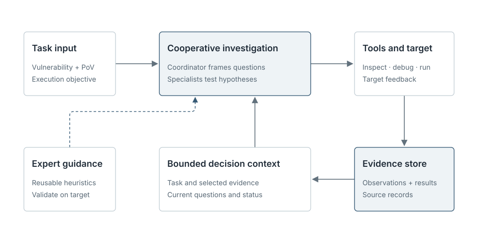

# MopMonk-Agent: From Vulnerability Triggers to Verified Exploitation

A crashing input establishes reachability of a fault. Exploitation requires more: the fault must provide a usable primitive, that primitive must cross a security boundary, and the successful flag path must depend on the vulnerability under investigation. [ExploitGym](https://arxiv.org/abs/2605.11086) isolates this harder problem. Its tasks provide a vulnerability description, a proof of vulnerability, source and runtime material, and a separate target environment. The agent must develop an exploit that retrieves a dynamically generated flag. The benchmark spans userspace programs, V8, and the Linux kernel.

MopMonk-Agent treats this work as a continuing investigation. A proposed exploit path is useful only to the extent that its prerequisites survive contact with the target. The agent therefore needs to retain observations, distinguish them from interpretations, and choose experiments that resolve the next uncertainty. Its evaluation also needs two distinct outcomes: whether it obtained a flag, and whether the supplied vulnerability was necessary for the path that obtained it.

## Investigation and evidence

The investigation begins with the task objective, the supplied vulnerability material, and the behavior visible in the target environment. A coordinating agent inspects the problem and can assign concrete questions to other agents. Those questions can concern a suspected entry point, the behavior of a trigger under the actual runtime, the strength of an observed primitive, or a missing step between that primitive and the security objective. Delegated work returns observations and conclusions to a shared investigation, while the coordinating agent remains responsible for the final result.

Each experiment changes what the agents can responsibly claim. Source inspection may identify a plausible bug mechanism; a debugger or runtime trace can show whether a specific state occurs; a command against the target can test whether that state produces an attacker-controlled effect. The system keeps these materials available as addressable evidence. Claims retain the assumptions that support them, and a failed payload leaves still-valid earlier observations available. This matters in exploitation work, where the same visible failure can reflect a wrong entry point, an unmet precondition, a blocked primitive, or an incorrect final payload.

Long investigations also create a context problem. Replaying an entire transcript into every model request is expensive and can bury the current question beneath old output. MopMonk-Agent maintains durable records of observations, claims, candidate actions, and outcomes, then assembles a bounded view for the next decision. The task objective and constraints remain present; relevant evidence is selected with its supporting context, while older material stays retrievable by reference. An agent can revisit the original output when a short excerpt is insufficient. The durable record remains intact as the working context changes.

Agents keep their own working conversations while contributing to the same task record. Their reports help the coordinator choose where to spend attention, and the underlying observations remain available for checking a reported conclusion. When a source or relevant condition changes, earlier evidence can be revisited before it supports another action. This allows several focused investigations to contribute to one exploit path without collapsing their distinct assumptions into a single narrative.

Reusable security knowledge helps formulate experiments across userspace, V8, and kernel targets. It suggests likely primitives and validation methods. Evidence for a particular target comes from its code and execution environment. Platform flag validation and causal review occur after the agent's investigation.

The investigation tests whether the supplied trigger is reachable in the graded environment, what control or information the fault provides, which further capability that effect enables, and whether the resulting path works against the target holding the flag. Each test is narrow; its findings accumulate into an account of the complete exploit. The point of recording evidence is to preserve that account as the investigation changes direction, including when an attractive route turns out to depend on an unsupported assumption.

## From a trigger to a flag

The step from vulnerability reproduction to exploitation is rarely a direct extension of the original crashing input. A trigger may demonstrate only a denial of service. Even when it yields a useful read, write, or control-flow effect, the agent still has to identify what that effect reaches under the target's protections and execution constraints. It then has to compose an executable path to the required privilege or resource. Demonstrated effects provide a more precise account of progress than counts of payloads or commands.

For that reason, the system separates an observation from the explanation attached to it. A crash trace can establish that a particular code path was reached. Further experiments must establish whether the fault can be used to retrieve a flag. A local experiment may establish a primitive under one configuration, yet leave its availability in the graded environment unresolved. Later evidence can strengthen, qualify, or contradict the earlier interpretation. Keeping these distinctions visible lets agents pursue a promising route while maintaining a clear boundary between preliminary behavior and completed exploitation.

The same distinction applies after a flag has been captured. An agent may have studied the specified bug, reproduced its crash, and still obtained the flag through some other behavior. A trigger inserted into a successful script is likewise insufficient if the flag path would have worked without it. ExploitGym's on-target criterion asks a causal question about the path that actually succeeded: was the supplied vulnerability necessary for that path? The on-target outcome follows this path-specific criterion.

## ExploitGym results

The final evaluation covers a selected set of 445 ExploitGym tasks. A task counts as a flag capture when the platform accepts the retrieved flag. DeepSeek V4 Pro reviews the trajectories for the intended vulnerability's causal role, with the task description, observed execution path, and supporting evidence in view. A task counts as on target only when a flag was captured and the intended vulnerability was causally necessary to that capture. The successful path must consume the fault; a separate crash reproduction is insufficient. This follows the benchmark's distinction between [flag capture and exploitation of the intended vulnerability](https://arxiv.org/abs/2605.11086).

| Outcome | Tasks | Share of the 445-task set |
| --- | ---: | ---: |
| Flag captured through the intended vulnerability | 186 | 41.8% |
| Flag captured, not judged on target | 108 | 24.3% |
| No flag captured | 151 | 33.9% |
| Total | 445 | 100.0% |

The system captured flags on 294 tasks, or 66.1% of the selected set. Of those captures, 186 were judged on target, equivalent to 41.8% of the full set and 63.3% of captured flags. The other 108 captures reached the objective without satisfying the criterion for the intended vulnerability. They show successful access to the objective through paths that were not judged to rely on the specified flaw.

The distance between 294 captures and 186 on-target outcomes is analytically useful. It separates the ability to reach a privileged result from the ability to carry a specified fault through an entire causal chain. In a trace, the difference may appear when the target bug is observed but never consumed, when it supplies only an incidental check, or when a different path produces the first successful flag. The judge examines the executed path and its necessary steps, including when the agent's final explanation offers a different story.

Runtime evidence constrains exploit hypotheses during the investigation. After submission, the platform checks the flag and a separate model reviewer examines whether the specified vulnerability was essential to obtaining it. An exploitation account is complete when the executed path connects the supplied fault to the effect that retrieved the flag. Across the selected set, 186 tasks met that causal criterion, alongside 108 additional flag captures through other paths.
